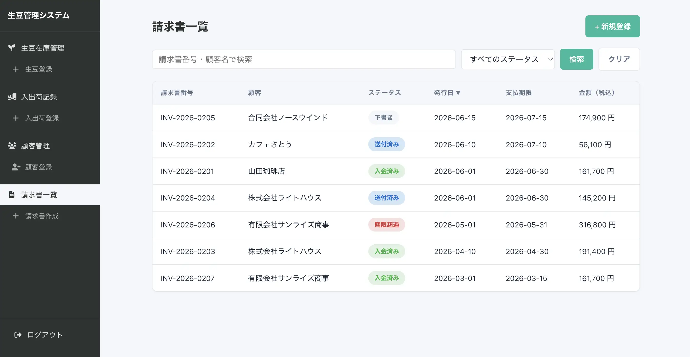
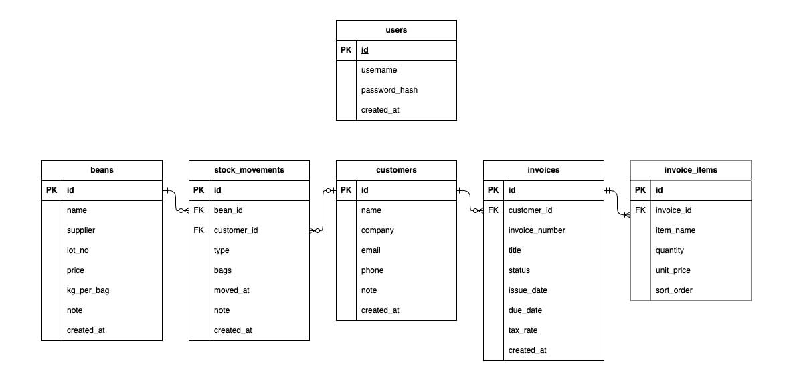

# 生豆管理システム



コーヒー生豆の在庫・入出荷・顧客・請求書をまとめて管理できる業務用Webアプリです。生豆の銘柄ごとに「入荷・予約・出荷」を記録して在庫数と未出荷数を自動で集計し、同じ顧客データから請求書の作成・印刷までを1つのアプリで行えるようにしました。

- **デモ**：https://gs2026-arakawa.sakura.ne.jp/kadai08_db2_v2/public/login.php
- **テストアカウント**：ユーザー名 `demo` / パスワード `demo`

別々に作成した「生豆在庫管理アプリ」と「請求書管理アプリ」を、1つのデータベースに統合して作り直しました。

---

## 主な機能

### 生豆在庫

- 生豆銘柄（商品名・仕入先・Lot No.・販売定価・1袋あたりの重量）の登録・編集・削除
- 入荷・予約・出荷の記録から、銘柄ごとの在庫数と未出荷数を自動で集計
- 在庫が5袋以下の銘柄を一覧で強調表示
- 「未予約在庫」「予約中・未出荷」「出荷済み」の割合をドーナツグラフで表示
- 商品名・仕入先でのキーワード検索と、各列での並べ替え

### 入出荷記録

- 入荷・予約・出荷の記録の登録・編集・削除
- 記録ごとに出荷先の顧客を紐づけ

### 顧客

- 顧客（氏名・会社名・メールアドレス・電話番号・備考）の登録・編集・削除
- 顧客名・メールアドレスでのキーワード検索と並べ替え

### 請求書

- 請求書の作成・編集・削除（明細行は画面上で追加・削除できる）
- 入力内容を画面右側のA4プレビューにリアルタイムで反映
- 明細の金額・小計・消費税・合計を入力に合わせて自動計算
- 印刷用のプレビュー画面

### アカウント

- ログイン・ログアウト（セッション認証）

---

## 使用技術

| 分類 | 技術 |
|---|---|
| フロントエンド | HTML / CSS / JavaScript / ApexCharts / Font Awesome |
| バックエンド | PHP（フレームワークなし・PDO） |
| データベース | MySQL |
| インフラ | さくらのレンタルサーバー（本番）／ MAMP（ローカル開発） |

### ディレクトリ構成

```
.
├── public/            # 画面（ドキュメントルート）
│   ├── bean_*.php      # 生豆銘柄のCRUD・在庫一覧
│   ├── movement_*.php  # 入出荷記録のCRUD
│   ├── customer_*.php  # 顧客のCRUD
│   ├── invoice_*.php   # 請求書のCRUD・印刷プレビュー
│   ├── css/
│   └── js/             # グラフ・明細行の追加・金額計算・リアルタイムプレビュー
├── config/            # DB接続・.env読み込み・ログインチェック・共通関数・サイドバー
└── invoice-frontend/  # React版フロントエンド（作成中）
```

---

## DB設計



| テーブル | 内容 |
|---|---|
| `users` | ログインユーザー |
| `beans` | 生豆銘柄 |
| `stock_movements` | 入出荷記録（入荷・予約・出荷） |
| `customers` | 顧客 |
| `invoices` / `invoice_items` | 請求書と明細 |

### 削除時の挙動

データの意味を考えて、外部キーごとに削除時の挙動を変えています。

- **請求書 → 明細、生豆 → 入出荷記録**：親を削除すると子も削除します（`ON DELETE CASCADE`）。明細や記録だけが残っても意味がないためです。
- **顧客 → 請求書**：請求書が紐づいている顧客は削除できません（`NO ACTION`）。請求実績のある顧客を誤って削除すると、過去の請求書がどの顧客のものか分からなくなるためです。
- **顧客 → 入出荷記録**：顧客を削除しても入出荷記録は残し、顧客を「未設定」にします（`ON DELETE SET NULL`）。入出荷の記録は在庫数の計算に必要なため、顧客の有無にかかわらず保持しています。

---

## 工夫した点

### 在庫の集計

- 在庫数を `beans` テーブルに持たせず、入出荷記録を `SUM(CASE WHEN ...)` で集計して求めています。記録を修正・削除しても在庫数がずれることがありません。
- `LEFT JOIN` にすることで、入出荷記録がまだない銘柄も在庫0として一覧に表示されます。

### セキュリティ

- **SQLインジェクション対策**：すべてのクエリでプリペアドステートメント（PDO）を使っています。並べ替えの列名はプレースホルダーにできないため、許可した列名の一覧と照合してからSQLに組み込んでいます。
- **XSS対策**：画面に出力する値はすべて `htmlspecialchars` でエスケープしています。
- **パスワード**：`password_hash` / `password_verify` でハッシュ化して保存・照合しています。
- **セッション固定攻撃対策**：ログイン成功時に `session_regenerate_id` でセッションIDを再発行しています。
- DBの接続情報は `.env` に分けて、リポジトリには含めていません。

### データの整合性

- 請求書と明細は、トランザクションでまとめて登録・更新しています。途中でエラーが起きても、明細が欠けた請求書が残りません。

### 使いやすさ

- 生豆の商品名・仕入先の入力欄に `<datalist>` を使い、登録済みのデータを候補に出しつつ自由入力もできるようにしました。
- 請求書の作成画面では、入力しながら仕上がりをA4プレビューで確認できるようにしました。単価は入力中に3桁区切りで表示します。
- 一覧の行をクリックすると編集画面に移動できます。スマートフォンではサイドバーをハンバーガーメニューで開閉できます。

---

## 苦労した点

- 生豆管理と請求書管理は最初は別々のDBで作っていたため、統合するときに両方の顧客テーブルの項目の違い（会社名・電話番号・備考の有無）をそろえ、どちらの機能からも同じ顧客テーブルを参照できるように作り直す必要がありました。

---

## 今後の展望

- React によるフロントエンドの作り直し（`invoice-frontend/` で作成中）
- フォームへの CSRF トークンの導入
- 請求書の PDF 出力
